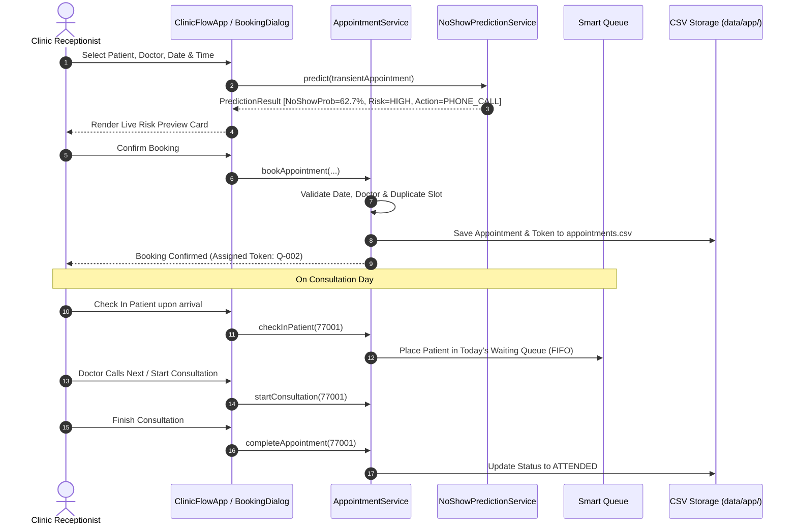

# ClinicFlow — Application Workflow & Lifecycle Guide

This document outlines the clinical operational workflow of ClinicFlow, detailing how data flows from patient registration through ML prediction, smart queue sequencing, and reminder simulation.

---

## 1. End-to-End Workflow Diagram

---

## 2. Detailed Lifecycle Stages

### Stage 1: Patient Registration & Profile Validation
* The receptionist registers the patient in the **Patients** screen.
* Input validation rules:
  * Full name must be non-empty.
  * Age must be a valid integer between 0 and 125.
  * Contact phone format is validated.
  * Medical history flags (Hypertension, Diabetes, Alcoholism, Welfare enrollment) are recorded.
* The patient ID is automatically generated, and the record is stored in `data/app/patients.csv`.

### Stage 2: Doctor Onboarding & Availability Management
* Clinic physicians are registered in the **Doctors** screen with specialty and consultation room.
* Physicians can have their availability toggled (e.g. for leave or emergency duty).
* **Validation Rule:** The system prevents scheduling consultations with doctors marked as unavailable.
* **Deletion Guard:** A doctor with active or upcoming appointments cannot be deleted from the system.

### Stage 3: Appointment Booking & Real-Time ML Risk Assessment
* During booking, the receptionist selects the patient, doctor, date, time slot, and clinic neighborhood.
* **Pre-Booking Validations:**
  1. Appointment date cannot be in the past relative to the scheduling date.
  2. The attending doctor must be marked as available.
  3. No duplicate appointment can exist for the same doctor at the same date and time slot.
* **Real-Time Weka Inference:**
  * As soon as patient and date are chosen, `FeatureExtractor` extracts the 6 operational booking-time features (`leadTimeDays`, `appointmentWeekday`, `bookingWeekday`, `bookingHour`, `sameDayBooking`, `age`).
  * `NoShowPredictor` executes Weka's `distributionForInstance()`.
  * The dialog renders the predicted no-show probability, attendance probability, risk tier (`LOW`, `MEDIUM`, `HIGH`), and recommended clinical action.
  * The dialog explicitly displays the notice: *"Model-estimated no-show score – not a calibrated probability."*
* The appointment is assigned a unique queue token (e.g. `Q-002`) and persisted in `data/app/appointments.csv`.

### Stage 4: Smart Waiting Queue & Arrival Check-In
* When the patient arrives at the clinic, the receptionist clicks **Check In Patient**.
* The appointment transitions from `SCHEDULED` to `CHECKED_IN`, recording the arrival timestamp (`checkInTime`).
* The patient appears in today's active waiting room queue in the **Queue Management** screen.
* **Operational Fairness Policy:**
  * Queue sequencing is strictly FIFO (First-In, First-Out) based on check-in arrival time and appointment time.
  * The Machine Learning risk score is purely advisory for front-desk reminder outreach and **never** lowers a patient's position in the queue, denies service, or delays medical care.

### Stage 5: Consultation Progression & Attendance Recording
* When the doctor is ready, the receptionist selects the patient in the queue and clicks **Call Next / Start Consultation**. The status transitions to `IN_CONSULTATION`.
* Upon finishing the medical consultation, clicking **Finish Consultation** marks the status as `ATTENDED`.
* If a patient never arrives for their scheduled consultation, the receptionist records an actual `NO_SHOW`.
* High-risk predictions **never** automatically mark an appointment as a no-show.

### Stage 6: Automated Reminder Simulation & Audit Trail
* The **Reminder Management** screen automatically identifies upcoming appointments requiring patient outreach.
* Appointments are mapped to recommended outreach types based on the ML risk score:
  * **Low Risk (< 20%):** Standard automated SMS 24 hours prior.
  * **Medium Risk (20% – 50%):** Enhanced SMS with confirmation link 48h and 24h prior.
  * **High Risk (≥ 50%):** Manual telephone call by front desk and priority confirmation.
* For academic coursework, clicking **Simulate Send Reminder** logs the dispatch locally with an exact timestamp and audit notes in `data/app/reminders.csv`, clearly stating: *"Reminder simulated for academic demonstration. No third-party messaging charges incurred."*
