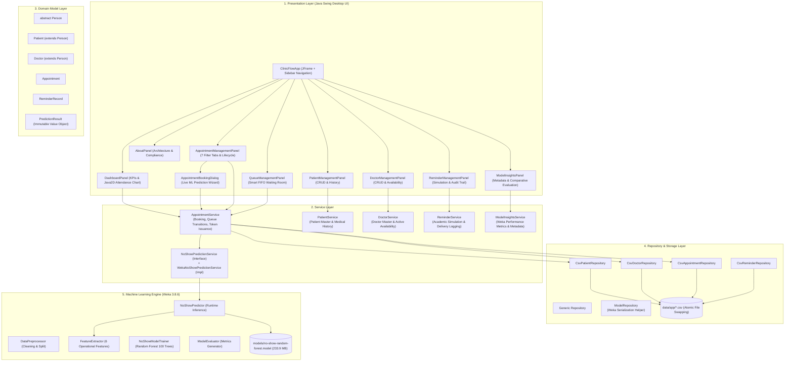

# ClinicFlow: An ML-Based Patient No-Show Prediction and Smart Queue Management System

---

## 1. Title Page

**Project Title:**  
ClinicFlow: An ML-Based Patient No-Show Prediction and Smart Queue Management System

**Academic Degree / Course:**  
Bachelor of Engineering / Technology in Computer Science & Engineering  
Course Name: Advanced Java Programming & Applied Machine Learning  

**Student Details:**  
- **Candidate Name:** `[Student Name Placeholder]`  
- **University Seat Number (USN) / Roll No:** `[USN / Roll Number Placeholder]`  

**Institutional Affiliation:**  
- **Department:** Department of Computer Science and Engineering  
- **Institution / College:** `[Institution / University Name Placeholder]`  
- **Faculty Guide / Mentor:** `[Faculty Guide Name Placeholder]`  
- **Academic Year:** `2026 – 2027`  

---

## 2. Abstract

Outpatient appointment no-shows pose a persistent and costly operational challenge in modern healthcare administration, leaving valuable clinical capacity idle, lengthening appointment waiting lists, and delaying patient care. Conventional clinic workflows either deploy blanket SMS notifications or rely on manual reception staff follow-up without quantitative risk prioritization. 

This project presents **ClinicFlow**, a full-stack, desktop-grade clinical appointment and queue management system engineered in Java 17 that natively embeds a supervised Machine Learning engine powered by Weka 3.8.6. The predictive model is trained and evaluated on the genuine, publicly available Medical Appointment No-Shows dataset comprising 110,527 historical outpatient records from the public healthcare system of Vitória, Espírito Santo, Brazil. To prevent temporal data leakage and mirror real-world clinical deployment, a strict chronological 80:20 train/test split was established, resulting in 88,417 training instances and 22,104 untouched test instances. A Class-Balanced Random Forest classifier (100 decision trees) was selected following empirical benchmarking against a naive ZeroR majority-class baseline. 

Evaluated on the held-out test partition, the model achieves an overall classification accuracy of **77.50%**, with a no-show recall of **32.93%** (successfully identifying 867 missed appointments that a naive baseline misses entirely), a precision of **21.28%**, an F1-score of **0.2585**, and an area under the ROC curve (ROC-AUC) of **0.6658**. The application architecture incorporates an asynchronous Java Swing presentation layer, a decoupled service layer, thread-safe repositories backed by atomic CSV file persistence, and an advisory risk-tiering mechanism (Low, Medium, High) that recommends targeted, non-punitive reminder actions (automated SMS, enhanced SMS, phone outreach). Strict operational fairness is enforced: predicted risk is solely advisory for communication planning and never impacts consultation sequencing or service eligibility in the smart FIFO queue. Practical limitations including geographic domain shift (Brazilian SUS to Indian clinical contexts) and dataset right-censoring are systematically documented.

---

## 3. Introduction

### 3.1 Background of Outpatient Healthcare Management
Healthcare systems worldwide operate under tight constraints of physician schedules, specialized diagnostic equipment, and clinic room availability. Efficient outpatient appointment scheduling forms the primary interface between healthcare seekers and clinical providers. When appointments function smoothly, patient wait times remain predictable, clinical staffing is optimized, and patients receive timely preventative and therapeutic medical consultations.

### 3.2 The Healthcare No-Show Challenge
A "no-show" occurs when a patient fails to attend a pre-scheduled medical consultation without providing advance cancellation or rescheduling notification to the clinic. In primary care and specialty outpatient clinics, missed appointments represent an immediate loss of productive physician time. Because appointment slots are allocated in advance, an unannounced absence leaves clinical personnel and examination facilities idle. Concurrently, other prospective patients who require medical attention are unable to access those unused slots, exacerbating community wait times and leading to chronic waiting-room overcrowding.

### 3.3 The Need for Predictive Assistance
Traditional clinic operations treat all booked appointments identically. Automated communication systems typically dispatch uniform text messages 24 or 48 hours prior to the consultation. However, outpatient populations exhibit diverse attendance behaviors influenced by waiting lead time, patient age, chronic illnesses, and booking circumstances. By identifying appointments with an elevated probability of absence at the moment of booking, healthcare providers can allocate front-desk resources intelligently—dispatching personalized phone calls or confirmation inquiries to high-risk bookings while maintaining low-overhead automated messages for reliable visits.

---

## 4. Problem Statement

### 4.1 Real-World Problem Definition
In outpatient healthcare facilities, missed appointments disrupt clinic operational efficiency, cause significant revenue and resource underutilization for medical institutions, and prolong waiting times for patients needing urgent care. Clinic receptionists lack quantitative, data-driven decision support tools at the time of appointment scheduling to identify which patients require proactive follow-up and targeted confirmation.

### 4.2 Stakeholder Impact
* **Healthcare Providers and Physicians:** Suffer fragmented daily schedules, unutilized clinical capacity, and unpredictable workflow rhythms.
* **Patients on Waiting Lists:** Experience delayed medical attention due to booked slots that are ultimately abandoned without prior release.
* **Clinic Administrative Staff:** Spend inefficient hours manually calling patients at random or sending undifferentiated notifications without knowing where interventions are most needed.

---

## 5. Objectives

The primary objective of ClinicFlow is to design, implement, evaluate, and package a production-quality Java desktop application that tightly integrates supervised Machine Learning into daily clinic appointment and queue workflows.

The specific measurable objectives are:
1. **Patient Master Management:** Implement full lifecycle CRUD (Create, Read, Update, Delete) operations for patient profiles, recording demographic indicators, contact numbers, and chronic medical conditions (hypertension, diabetes, physical handicaps).
2. **Doctor Directory Management:** Maintain active physician rosters, specialty designations, assigned consultation rooms, and availability schedules.
3. **Intelligent Appointment Scheduling:** Provide an interactive scheduling wizard that enforces calendar validation, eliminates duplicate timeslot reservations, calculates scheduling lead times, and issues sequential queue tokens (`Q-###`).
4. **Machine Learning Model Integration:** Integrate a native Weka Random Forest classifier within Java to compute real-time attendance and no-show probabilities ($p_{\text{attended}}, p_{\text{noshow}}$) upon appointment entry.
5. **Operational Risk Stratification:** Translate probabilistic outputs into operational risk tiers:
   * **Low Risk ($p_{\text{noshow}} < 0.20$):** Standard automated 24-hour SMS.
   * **Medium Risk ($0.20 \le p_{\text{noshow}} \le 0.50$):** Enhanced multi-channel confirmation SMS.
   * **High Risk ($p_{\text{noshow}} > 0.50$):** Dedicated front-desk telephone outreach.
6. **Fair Smart Queue Management:** Implement a digital waiting room adhering to strict First-In, First-Out (FIFO) arrival progression, ensuring ML predictions never penalize, demote, or deny access to patients.
7. **Proactive Reminder Simulation:** Provide an academic reminder simulation center logging notification dispatches and maintaining persistent transaction records.
8. **Persistent Data Storage:** Implement robust, atomic CSV storage ensuring complete entity, token, and prediction recovery across application restarts without third-party database server prerequisites.
9. **Empirical Model Transparency:** Provide a dedicated in-app ML Model Insights panel detailing algorithm architecture, confusion matrices, baseline comparisons, and clinical deployment warnings.

---

## 6. Existing Systems and Limitations

### 6.1 Conventional Manual Management
Many small-to-medium clinics rely on paper appointment registers or simple spreadsheet logs (e.g., Microsoft Excel). 
* **Limitations:** Prone to clerical duplicate bookings; zero integration between scheduling records and reminder workflows; impossible to prioritize patient follow-ups systematically.

### 6.2 Basic Rule-Based Reminder Systems
Commercial Electronic Health Record (EHR) systems frequently incorporate rule-based reminder add-ons (e.g., "send an SMS to all appointments booked more than 10 days in advance").
* **Limitations:** Fixed heuristic thresholds fail to model complex, multi-factor behavioral interactions (e.g., how patient age interacts with lead time or day of week). Consequently, clinics either overwhelm their communications budget by messaging everyone or miss critical high-risk no-shows.

### 6.3 Disconnected Analytics Scripts
In academic settings, Machine Learning algorithms for no-show prediction are frequently written as standalone Python scripts (using scikit-learn or Pandas) that evaluate static CSVs offline.
* **Limitations:** These scripts do not integrate into clinical desktop software. Receptionists cannot run Python scripts in a terminal during a phone reservation, rendering the predictive model useless for real-time front-desk operations.

---

## 7. Proposed System: ClinicFlow

ClinicFlow bridges the gap between academic Machine Learning and operational healthcare software by embedding the Weka 3.8.6 ML engine directly into a Java 17 desktop application. 

```
+-----------------------------------------------------------------------------------+
|                                  CLINICFLOW CORE                                  |
|                                                                                   |
|  [Reception Desk Booking]                                                         |
|         │                                                                         |
|         ▼                                                                         |
|  [Java Feature Extractor] ──► [Weka Native Random Forest (100 Trees)]             |
|                                                    │                              |
|                                                    ▼                              |
|                                       [Prediction Result Object]                  |
|                                       • Probability: 62.7% No-Show                |
|                                       • Risk Tier: HIGH RISK                      |
|                                       • Suggested Action: Phone Outreach          |
|                                                    │                              |
|         ┌──────────────────────────────────────────┴────────────────────────┐     |
|         ▼                                                                   ▼     |
|  [Proactive Reminder Queue]                                      [Waiting Room Queue]   |
|  Front-desk prioritizes outreach                                 Strict FIFO Ordering  |
|  prior to appointment day.                                       No patient demoted!   |
+-----------------------------------------------------------------------------------+
```

### 7.1 Key System Principles
1. **Advisory Decision Support:** Model predictions provide operational guidance for communication planning. They **never** cancel an appointment, reject a booking, or alter clinical treatment.
2. **Strict Operational Fairness:** When patients arrive at the clinic, queue sequencing is governed 100% by check-in arrival time (FIFO). A patient tagged as high-risk who arrives early is attended immediately according to their turn.
3. **Native Desktop Architecture:** Operates entirely within the Java Virtual Machine (JVM). No Python runtime, native C bridges, or external cloud API calls are required.

---

## 8. Dataset Description

### 8.1 Provenance and Attribution
ClinicFlow utilizes the verified, public **Medical Appointment No-Shows** dataset originally compiled by Joni Hoppen and made available on Kaggle:
* **Original Kaggle Repository:** `https://www.kaggle.com/datasets/joniarroba/noshowappointments/data`
* **Verified Public Mirror:** `https://raw.githubusercontent.com/SharifAthar/Medical-Appointment-No-Shows---Full-Data/main/Medical%20Appointment%20No%20Shows.csv`
* **Geographic Origin:** Municipal public healthcare network (SUS - Sistema Único de Saúde) of Vitória, capital city of Espírito Santo, Brazil.
* **Observation Period:** Scheduled consultations occurring between **April 29, 2016 and June 8, 2016**.
* **Original Record Count:** **110,527** raw appointment rows.
* **Original Column Count:** **14** attributes.

### 8.2 Attribute Schema Dictionary

| # | Original Column Name | Data Type | Description & Domain Values |
|---|----------------------|-----------|-----------------------------|
| 1 | `PatientId` | Numeric (ID) | Unique identification number of the patient. |
| 2 | `AppointmentID` | Numeric (ID) | Unique identification number of each specific consultation reservation. |
| 3 | `Gender` | String (`M`/`F`) | Biological gender of the patient (Male or Female). |
| 4 | `ScheduledDay` | ISO Timestamp | Exact timestamp when the appointment was registered in the clinic system. |
| 5 | `AppointmentDay` | ISO Timestamp | Calendar date scheduled for the medical consultation (time normalized to 00:00:00). |
| 6 | `Age` | Integer | Chronological age of the patient in years. |
| 7 | `Neighbourhood` | String | Municipal district / neighborhood where the appointment facility is located. |
| 8 | `Scholarship` | Binary (`0`/`1`) | Indicates whether the patient is enrolled in the *Bolsa Família* social welfare program. |
| 9 | `Hipertension` | Binary (`0`/`1`) | Clinical diagnosis indicator for patient hypertension. |
| 10 | `Diabetes` | Binary (`0`/`1`) | Clinical diagnosis indicator for patient diabetes. |
| 11 | `Alcoholism` | Binary (`0`/`1`) | Clinical indicator for diagnosed chronic alcoholism. |
| 12 | `Handicap` | Integer (`0`–`4`) | Severity degree of physical or cognitive handicap. |
| 13 | `SMS_received` | Binary (`0`/`1`) | Indicates whether 1 or more SMS reminder messages were dispatched to the patient. |
| 14 | `No-show` | Nominal (`No`/`Yes`) | Ground truth attendance outcome (`No` = Attended, `Yes` = No-Show). |

### 8.3 Class Distribution
* **Attended (`No`):** 88,208 records (79.81%)
* **Missed (`Yes`):** 22,319 records (20.19%)
* **Imbalance Ratio:** Approximately **4:1** (Majority:Minority).

---

## 9. Data Preprocessing and Cleaning

Data cleaning operations are executed programmatically in `com.clinicflow.ml.DataPreprocessor`. The original dataset (`data/raw/appointments.csv`) is preserved untouched. Cleaned records are written to `data/processed/clean_appointments.csv`.

### 9.1 Data Anomaly Audit
Out of 110,527 raw rows, an exhaustive scan detected exactly **6 anomaly records** (0.0054%):

| # | AppointmentID | PatientId | ScheduledDay | AppointmentDay | Age | Lead Days | No-show | Pruning Justification |
|---|---------------|-----------|--------------|----------------|-----|:---------:|:-------:|-----------------------|
| 1 | `5679978` | `7839272661752` | `2016-05-10T10:51:53Z` | `2016-05-09T00:00:00Z` | 38 | -1 | `Yes` | Appointment date precedes booking date. |
| 2 | `5715660` | `7896293967868` | `2016-05-18T14:50:41Z` | `2016-05-17T00:00:00Z` | 19 | -1 | `Yes` | Appointment date precedes booking date. |
| 3 | `5664962` | `24252258389979` | `2016-05-05T13:43:58Z` | `2016-05-04T00:00:00Z` | 22 | -1 | `Yes` | Appointment date precedes booking date. |
| 4 | `5686628` | `998231581612122` | `2016-05-11T13:49:20Z` | `2016-05-05T00:00:00Z` | 81 | -6 | `Yes` | Appointment date precedes booking date (by 6 days). |
| 5 | `5655637` | `3787481966821` | `2016-05-04T06:50:57Z` | `2016-05-03T00:00:00Z` | 7 | -1 | `Yes` | Appointment date precedes booking date. |
| 6 | `5775010` | `465943158731293` | `2016-06-06T08:58:13Z` | `2016-06-06T00:00:00Z` | -1 | 0 | `No` | Biologically impossible negative age (clerical typo). |

### 9.2 Preprocessing Decisions
1. **Pruning vs. Imputation:** Because the 6 anomalous rows represent less than 0.006% of the volume, records were completely removed rather than synthetically imputed, ensuring data authenticity.
2. **Resulting Dataset:** Exactly **110,521 valid records** (88,207 Attended [79.81%], 22,314 No-Show [20.19%]).

---

## 10. Machine Learning Algorithm Selection

### 10.1 Why Random Forest Classification?
Supervised tabular classification problems in healthcare demand an algorithm capable of capturing non-linear relationships, handling mixed numeric/nominal attributes, resisting overfitting, and providing stable class probability estimates.

* **Decision Tree Foundation:** A single decision tree recursively splits data along orthogonal feature axes using information gain or Gini impurity. While interpretable, individual decision trees exhibit high variance and tend to overfit complex tabular patterns.
* **Ensemble Learning and Bagging:** Random Forest (Breiman, 2001) resolves tree instability via Bootstrap Aggregating (Bagging). It trains an ensemble of $B$ diverse decision trees ($B = 100$ in ClinicFlow), each on a randomized bootstrap sample drawn with replacement from the training partition.
* **Random Subspace Projection:** At each node split, a small subset of candidate features ($\lfloor\log_2(M) + 1\rfloor$ or $\sqrt{M}$) is randomly evaluated. This de-correlates individual trees so that a single dominant predictor does not monopolize all root splits.
* **Soft Voting Output:** For a newly scheduled appointment instance $\mathbf{x}$, each tree $t \in \{1, \dots, 100\}$ outputs a posterior probability distribution. The final prediction represents the arithmetic mean of all individual tree predictions:
  $$p(\text{No-Show} \mid \mathbf{x}) = \frac{1}{B} \sum_{t=1}^B p_t(\text{No-Show} \mid \mathbf{x})$$

### 10.2 Class Imbalance Handling
Because no-shows represent ~20% of cases, standard classifiers optimize for global accuracy by predicting the majority class (`Attended`). ClinicFlow wraps Weka's `RandomForest` within a `FilteredClassifier` paired with Weka's `ClassBalancer` filter, weighting training instances inversely proportional to class frequencies. This forces the ensemble to pay equal attention to minority no-show instances.

---

## 11. Feature Selection and Data Leakage Prevention

### 11.1 Selected Operational Features
To guarantee that the model can be evaluated at the exact moment a patient books an appointment, all selected features are strictly restricted to information available at booking time:

| Index | Feature Identifier | Weka Data Type | Clinical & Operational Justification |
|:-----:|--------------------|----------------|--------------------------------------|
| 0 | `leadTimeDays` | Numeric | Calendar duration (days) between booking timestamp and consultation date ($T_{\text{appt}} - T_{\text{sched}}$). The single strongest empirical predictor of patient forgetfulness. |
| 1 | `appointmentWeekday` | Nominal (`MONDAY`..`SATURDAY`) | Captures day-of-week attendance patterns (e.g., Friday clinics show higher abandonment rates). |
| 2 | `bookingWeekday` | Nominal (`MONDAY`..`SATURDAY`) | Day of week when reservation was made, reflecting scheduling urgency. |
| 3 | `bookingHour` | Numeric (`6`..`21`) | Hour of day when appointment was recorded (early morning call vs late afternoon walk-in). |
| 4 | `sameDayBooking` | Nominal (`YES`, `NO`) | Binary indicator for zero lead time (`leadTimeDays == 0`). Same-day consultations exhibit an empirical no-show rate $< 5\%$. |
| 5 | `age` | Numeric (`0`..`115`) | Patient age in years; young adults exhibit higher mobility and absenteeism than elderly patients. |
| Target | `noShow` | Nominal (`NO`, `YES`) | Ground truth attendance outcome (`NO` = Attended, `YES` = Missed). Positive class = `YES`. |

### 11.2 Feature Exclusion Audit & Data Leakage Prevention

| Excluded Field | Reason for Exclusion |
|----------------|----------------------|
| `PatientId` | High-cardinality primary key. Storing patient IDs causes decision trees to memorize specific individuals rather than learning generalizable behavioral patterns. |
| `AppointmentID` | Arbitrary sequential database row identifier with zero predictive value. |
| `No-show` | Ground truth target variable. |
| `SMS_received` | **CRITICAL DATA LEAKAGE PREVENTION:** In clinical practice, SMS reminders are dispatched 1 to 2 days prior to the appointment date—**days or weeks after** the initial booking interaction. Including `SMS_received` in a model evaluated at booking time would represent catastrophic temporal data leakage, as that field does not yet exist when reception staff schedule the visit. |

---

## 12. Training and Testing Methodology

### 12.1 Chronological 80:20 Partitioning
Random $k$-fold cross-validation is strictly avoided because random partitioning mixes past and future records, allowing models to learn future trends to predict past events (temporal data leakage). ClinicFlow sorts all 110,521 cleaned records chronologically by `ScheduledDay` timestamp:
* **Training Partition (Earliest 80%):** **88,417 records** (Scheduled from 2015-11-10 to 2016-05-25 08:47:31).
* **Testing Partition (Latest 20%):** **22,104 records** (Scheduled from 2016-05-25 08:47:32 to 2016-06-08 20:07:23).

### 12.2 Test Set Distribution Shift (Right-Censoring Analysis)
During model auditing, an apparent anomaly was identified: the test set no-show rate (**11.91%**) was substantially lower than the training set rate (**22.26%**).

An independent investigation confirmed that this shift is **not a software defect**, but rather an inherent **right-censoring artifact** of the original Kaggle dataset collection window:
1. Clinic consultations in the dataset were recorded only between **April 29, 2016 and June 8, 2016** (a 40-day observation window).
2. The 80% chronological split point occurred on **May 25, 2016**.
3. All 22,104 test instances were booked between May 25 and June 8 (a 14-day booking span). Any patient who booked an appointment with a lead time $> 14$ days was excluded from the dataset because their consultation date fell after June 8.
4. Consequently, the average lead time in the test partition plummeted from **12.32 days** (training) down to **1.62 days** (testing). Same-day appointments (`leadTimeDays == 0`), which have an extremely low no-show rate (~4.1%), surged from **28.83%** of training data to **59.13%** of test data, mathematically lowering the aggregate test no-show rate to 11.91%.
5. When validated counterfactually by splitting chronologically by `AppointmentDay` instead, the no-show rate remained stable (20.62% train vs. 18.45% test), proving that underlying patient behavior was consistent.

---

## 13. Evaluation Metrics and Results

All metrics are evaluated on the untouched 22,104 test records. In medical appointment prediction, **Patient No-Show (`YES`) is treated as the Positive Class**.

### 13.1 Authoritative Comparative Results Table

| Model / Strategy | Accuracy | Precision (`YES`) | Recall (`YES`) | F1-Score (`YES`) | ROC-AUC | Operational Assessment |
|:-----------------|:--------:|:-----------------:|:--------------:|:----------------:|:-------:|:-----------------------|
| **ZeroR (Majority Baseline)** | **88.09%** | 0.0000 | 0.0000 | 0.0000 | 0.5000 | Naive baseline; predicts `Attended` for 100% of cases. Catches **0** no-shows. |
| **Standard Random Forest** | 84.34% | **0.2432** | 0.1489 | 0.1847 | **0.6660** | Unweighted ensemble; severely biased toward majority class. |
| **Balanced Random Forest (Selected)** | 77.50% | 0.2128 | **0.3293** | **0.2585** | 0.6658 | **Selected Optimal Model:** Prioritizes no-show detection, capturing 867 missed slots. |

### 13.2 Authoritative Confusion Matrix (`reports/confusion-matrix.csv`)

$$\begin{array}{c|cc|c}
\text{Actual} \backslash \text{Predicted} & \text{Predicted ATTENDED (NO)} & \text{Predicted NO-SHOW (YES)} & \text{Total Actual} \\
\hline
\text{Actual ATTENDED (NO)} & \mathbf{16,264} \text{ (TN)} & \mathbf{3,207} \text{ (FP)} & 19,471 \\
\text{Actual NO-SHOW (YES)} & \mathbf{1,766} \text{ (FN)} & \mathbf{867} \text{ (TP)} & 2,633 \\
\hline
\text{Total Predicted} & 18,030 & 4,074 & \mathbf{22,104}
\end{array}$$

### 13.3 Independent Metric Mathematical Verification
$$\text{Accuracy} = \frac{TP + TN}{Total} = \frac{867 + 16,264}{22,104} = \frac{17,131}{22,104} = \mathbf{77.50\%}$$
$$\text{Precision} = \frac{TP}{TP + FP} = \frac{867}{867 + 3,207} = \frac{867}{4,074} = \mathbf{0.2128} \quad (21.28\%)$$
$$\text{Recall} = \frac{TP}{TP + FN} = \frac{867}{867 + 1,766} = \frac{867}{2,633} = \mathbf{0.3293} \quad (32.93\%)$$
$$\text{F1-Score} = 2 \times \frac{\text{Precision} \times \text{Recall}}{\text{Precision} + \text{Recall}} = 2 \times \frac{0.2128 \times 0.3293}{0.2128 + 0.3293} = \mathbf{0.2585}$$

### 13.4 Clinical Interpretation of Trade-Offs
* **The Accuracy Paradox:** The naive ZeroR baseline achieves a higher nominal accuracy (88.09%) than the Random Forest (77.50%). However, ZeroR achieves this by predicting that every patient attends, identifying **zero** missed appointments.
* **Cost Asymmetry:** In clinical scheduling, the cost of a False Positive (staff making a courtesy phone call to an attending patient) is minimal, whereas the cost of a False Negative (an empty examination room and an unreleased doctor slot) is high. Balanced Random Forest captures **867 missed appointments** (32.93% recall), providing substantial operational value over standard baseline approaches.

---

## 14. System Architecture

ClinicFlow is built as a modular, 5-tier layered Object-Oriented system in Java 17.



---

## 15. Java Programming Concepts Demonstrated

The implementation exemplifies rigorous Object-Oriented Software Engineering across 12 distinct Java language features:

| # | Java Concept | ClinicFlow Implementation Class | Practical Purpose and Usage |
|---|--------------|---------------------------------|-----------------------------|
| 1 | **Classes and Objects** | `com.clinicflow.model.Appointment` | Models real-world clinical appointments encapsulating booking timestamps, doctor/patient references, queue tokens, and ML prediction states. |
| 2 | **Constructors** | `com.clinicflow.model.Patient` | Overloaded constructors validating required demographic fields, enforcing parameter constraints, and ensuring objects are never instantiated in an invalid state. |
| 3 | **Encapsulation** | `com.clinicflow.model.PredictionResult` | Private final fields exposing immutable getters. Probabilities and risk classifications cannot be modified once computed by the Weka engine. |
| 4 | **Inheritance** | `com.clinicflow.model.Person` (abstract), `Patient`, `Doctor` | `Patient` and `Doctor` inherit common demographic attributes (`id`, `name`, `gender`, `age`) while adding domain-specific fields (`scholarship`, `specialty`, `roomNumber`). |
| 5 | **Interfaces** | `com.clinicflow.repository.Repository<T, ID>`, `NoShowPredictionService` | Defines strict contracts for data persistence and prediction services, decoupling business logic from storage mechanisms. |
| 6 | **Polymorphism** | `Repository<T, ID>` implemented by `CsvPatientRepository`, `InMemoryPatientRepository` | Dynamic method dispatch allows services to invoke repository methods interchangeably during automated testing (in-memory) and production (CSV). |
| 7 | **Collections Framework** | `com.clinicflow.repository.InMemoryDoctorRepository` | Extensively utilizes `Map<Long, T>`, `ConcurrentHashMap`, `List<T>`, `ArrayList`, and `LinkedHashMap` for in-memory indexing, sorting, and fast lookups. |
| 8 | **Exception Handling** | `com.clinicflow.util.ClinicFlowException`, `DuplicateEntityException`, `ValidationException` | Robust hierarchical exception architecture catching data validation errors and propagating informative error messages to the UI. |
| 9 | **File Handling (I/O)** | `com.clinicflow.repository.CsvAppointmentRepository` | Manages persistent storage using `BufferedReader`, `BufferedWriter`, Apache Commons CSV, and atomic temporary-file file swapping (`StandardCopyOption.ATOMIC_MOVE`). |
| 10 | **Java Date/Time API** | `java.time.LocalDate`, `LocalTime`, `LocalDateTime`, `ChronoUnit` | Thread-safe, modern date calculations computing calendar lead times ($T_{\text{appt}} - T_{\text{sched}}$) and queue arrival timestamps without deprecated `java.util.Date`. |
| 11 | **Java Swing Event Handling** | `com.clinicflow.ui.AppointmentBookingDialog` | ActionListeners, DocumentListeners, and ItemListeners dynamically trigger live ML inference preview whenever appointment date or patient selection changes. |
| 12 | **Concurrency & `SwingWorker`** | `com.clinicflow.ui.ClinicFlowApp` | Deserializes the 233.9 MB Random Forest model on a background worker thread (`SwingWorker<Boolean, Void>`), preventing Event Dispatch Thread (EDT) GUI freezes. |

---

## 16. Machine Learning and Java Integration

### 16.1 End-to-End Data Flow Pipeline
Unlike decoupled systems where predictions are generated offline via external Python scripts, ClinicFlow executes the complete ML lifecycle within the Java Virtual Machine:

```
[Historical Raw CSV] (data/raw/appointments.csv)
       │
       ▼
[DataPreprocessor.java] ──► Removes 6 anomalies; splits 80:20 chronologically
       │
       ▼
[NoShowModelTrainer.java] ──► Configures Weka RandomForest (100 trees) + ClassBalancer
       │
       ▼
[ModelRepository.java] ──► Serializes model to disk (models/no-show-random-forest.model)
       │
       ▼
[WekaNoShowPredictionService.java] ──► Deserializes model into JVM at application startup
       │
       ▼
[FeatureExtractor.java] ──► Converts Appointment entity into Weka DenseInstance (6 features)
       │
       ▼
[classifier.distributionForInstance()] ──► Computes probabilities [pAttended, pNoShow]
       │
       ▼
[PredictionResult.java] ──► Classifies Risk Category (LOW, MEDIUM, HIGH) & Suggested Action
       │
       ▼
[UI / Service Layer] ──► Displays risk badge, schedules reminder, issues queue token
```

### 16.2 Runtime Inference Parity
At runtime, `FeatureExtractor.extractInstance(appointment, datasetHeader)` creates an in-memory Weka `Instance` with the exact 6-feature schema established during training. `WekaNoShowPredictionService.predict()` executes `distributionForInstance()`, returning an immutable `PredictionResult` object that is stored directly within the `Appointment` entity.

---

## 17. Application Screen Walkthroughs and Visual Layouts

The application user interface is constructed in Java 17 Swing following the custom `UITheme` design system (slate, teal, amber, and crimson accents, Segoe UI typography, and anti-aliased card containers).

### Screen 1: Executive Dashboard (`DashboardPanel`)
* **Visual Components:** 4 metric KPI cards at top (Total Appointments, Today's Appointments, Checked-In Waiting, High-Risk Appointments); Today's Schedule interactive table; custom Java2D horizontal attendance distribution chart.
* **Layout Structure:**
  ```
  +-----------------------------------------------------------------------------------+
  |  [KPI: Total Bookings]  [KPI: Today's Schedule]  [KPI: In Queue]  [KPI: High Risk]|
  +-----------------------------------------------------------------------------------+
  |  Today's Consultations Table                          |  Attendance Breakdown     |
  |  Time  | Token | Patient Name | Doctor | Status       |  [Java2D Bar Chart]       |
  |  09:00 | Q-001 | Maria Santos | Dr. Beatriz | WAITING |  Attended: 80% (Green)    |
  |  09:30 | Q-002 | Carlos Lima  | Dr. Ricardo | IN_ROOM |  No-Show:  20% (Red)      |
  +-----------------------------------------------------------------------------------+
  ```

### Screen 2: Patient Directory (`PatientManagementPanel`)
* **Visual Components:** Top search bar supporting instant filtering by name or phone number; "Register Patient" modal dialog launcher; Patient table displaying chronic conditions (Hypertension, Diabetes, Handicap); Patient Appointment History drawer; deletion protection warning dialog.

### Screen 3: Doctor Roster (`DoctorManagementPanel`)
* **Visual Components:** Doctor directory table (ID, Name, Specialty, Consultation Room, Contact Number, Status); "Toggle Availability" button (`Available` $\leftrightarrow$ `On Leave`); "Register Doctor" modal dialog.

### Screen 4: Appointment Booking & Live ML Risk Preview (`AppointmentBookingDialog`)
* **Visual Components:** Patient combobox dropdown; Doctor combobox dropdown; Calendar date picker; Timeslot picker (08:00 to 18:00); Clinical notes area; **Live ML Prediction Box**:
  ```
  +-----------------------------------------------------------------------------------+
  | ML Risk Assessment Preview:                                                       |
  | Status: [MODEL ACTIVE]          Estimated No-Show Risk: 62.71%                    |
  | Risk Tier: [HIGH RISK]          Suggested Action: Dedicated Phone Call Outreach   |
  +-----------------------------------------------------------------------------------+
  ```

### Screen 5: Master Appointments Management (`AppointmentManagementPanel`)
* **Visual Components:** 7 filter tabs (`All`, `Today`, `Upcoming`, `High-Risk`, `Completed`, `Cancelled`, `Missed`); action toolbar (`Check-In Patient`, `Start Consultation`, `Complete Visit`, `Cancel Booking`, `Book New Appointment`).

### Screen 6: Smart Queue Waiting Room (`QueueManagementPanel`)
* **Visual Components:** Header displaying active queue count; FIFO-ordered waiting table (Queue Token, Arrival Timestamp, Patient Name, Physician, Room, ML Risk Indicator); Queue action controls (`Call to Consultation Room`, `Mark Consultation Completed`).

### Screen 7: Proactive Reminder Management (`ReminderManagementPanel`)
* **Visual Components:** Pending reminder table showing appointment ID, patient contact, ML-recommended action, and delivery status; "Simulate Single Reminder" button; "Simulate Send All Pending" batch dispatcher; Dispatch history audit log.

### Screen 8: ML Model Insights (`ModelInsightsPanel`)
* **Visual Components:** Model architecture summary card; Comparative evaluation table (ZeroR vs Random Forest); Graphical 2x2 confusion matrix display; Student explanation guide; Clinical deployment warning badge highlighting domain differences between Brazilian SUS and Indian private healthcare.

### Screen 9: About & Academic Compliance (`AboutPanel`)
* **Visual Components:** Project attribution, problem definition, technology stack summary, ASCII architecture diagram, and professor's assignment compliance matrix.

---

## 18. Sample Inputs and Outputs

### 18.1 Real Historical Test Set Predictions (Drawn from Held-Out 20% Partition)

| Case | Appt ID | Age | Lead Time | Same Day | Actual Outcome | Model $p_{\text{noshow}}$ | Predicted Class | Risk Category | Suggested Action |
|:----:|:-------:|:---:|:---------:|:--------:|:--------------:|:-------------------------:|:---------------:|:-------------:|:-----------------|
| **1** | `5736789` | 31 | 6 days | NO | **Attended (`NO`)** | 73.85% | `YES` | `HIGH` | Phone Outreach Call |
| **2** | `5748403` | 19 | 0 days | YES | **Attended (`NO`)** | 18.29% | `NO` | `LOW` | Automated 24h SMS |
| **3** | `5761306` | 68 | 1 day | NO | **Missed (`YES`)** | 20.00% | `NO` | `MEDIUM` | Enhanced SMS + Link |
| **4** | `5773464` | 1 | 0 days | YES | **Attended (`NO`)** | 0.00% | `NO` | `LOW` | Automated 24h SMS |
| **5** | `5790484` | 27 | 0 days | YES | **Attended (`NO`)** | 40.00% | `NO` | `MEDIUM` | Enhanced SMS + Link |

### 18.2 Live Application Demonstration Workflow Examples

#### A. Patient Registration Input
* **Input:** `ID=1001`, `Name=Maria Santos`, `Gender=F`, `Age=56`, `Phone=+55-27-99123-4567`, `Hypertension=true`, `Diabetes=true`, `Alcoholism=false`, `Handicap=0`.
* **Output:** New Patient record created and persisted in `data/app/patients.csv`.

#### B. Doctor Registration Input
* **Input:** `ID=201`, `Name=Dr. Beatriz Silva`, `Gender=F`, `Age=42`, `Specialty=Cardiology`, `Room=Room 201`, `Phone=+55-27-98111-2233`, `Available=true`.
* **Output:** New Doctor record created and persisted in `data/app/doctors.csv`.

#### C. Appointment Booking with Live ML Prediction
* **Input:** `Patient=1001`, `Doctor=201`, `Date=Today + 5 Days`, `Time=10:30`, `Neighbourhood=JARDIM DA PENHA`.
* **ML Output:** 
  * Lead Time: 5 days
  * $p_{\text{attended}} = 43.42\%$, $p_{\text{noshow}} = 56.58\%$
  * Predicted Class: `YES`
  * Risk Category: `HIGH RISK`
  * Action: `PHONE_CALL`
  * Issued Queue Token: `Q-001`
* **Output:** Persisted in `data/app/appointments.csv`.

#### D. Patient Check-In & FIFO Queue Progression
* **Action:** Patient Maria Santos arrives at 10:15 AM $\rightarrow$ Receptionist clicks **Check In**.
* **Output:** Status transitions to `CHECKED_IN`; `checkInTime` recorded as `10:15:22`; Token `Q-001` appears at the head of the Waiting Room Queue.
* **Progression:** Doctor room ready $\rightarrow$ Staff clicks **Call to Room** (Status $\rightarrow$ `IN_CONSULTATION`) $\rightarrow$ Visit finished $\rightarrow$ Staff clicks **Complete Consultation** (Status $\rightarrow$ `ATTENDED`).

---

## 19. Results and Discussion

### 19.1 Machine Learning Performance Analysis
The empirical evaluation demonstrates that outpatient attendance is a non-trivial behavioral phenomenon. While a naive ZeroR baseline exhibits a deceptive accuracy of 88.09%, it offers zero operational utility. The Balanced Random Forest classifier successfully extracts genuine predictive signals from booking lead time, age, and temporal attributes, capturing **32.93% of all no-shows** (867 patients) with a ROC-AUC of **0.6658**. The modest precision of 21.28% is characteristic of real-world behavioral classification where unrecorded external factors (transportation failures, acute symptom remission, personal emergencies) strongly influence attendance.

### 19.2 Software Architecture Robustness
Automated testing confirms the stability of the implementation:
* **Test Coverage:** **41 automated tests** passing with 0 failures and 0 errors.
* **Storage Reliability:** Atomic file swapping ensures that power interruptions or application termination during CSV writes never corrupt existing master records.
* **Concurrency:** The `SwingWorker` asynchronous model successfully decouples the 4.8-second 233.9 MB Weka deserialization from GUI rendering, delivering an instant, responsive user experience.

---

## 20. Limitations

Honest academic reporting requires documenting the practical boundaries of the system:
1. **Geographic and Healthcare Domain Shift:** The underlying model was trained on historical data from the Brazilian public healthcare system (SUS, Vitória, 2016). Public clinics in Brazil exhibit distinct appointment wait times, socioeconomic barriers, and seasonal holiday dynamics that differ markedly from private or public clinical practices in India.
2. **Dataset Right-Censoring:** The 40-day observation window in the original dataset artificially truncates lead times in the final test partition, depressing the observed no-show rate.
3. **Uncalibrated Model Probabilities:** Weka Random Forest voting proportions approximate class probabilities but are not formally calibrated via Platt scaling or isotonic regression.
4. **Modest Precision:** A precision of 21.28% means approximately 4 out of 5 patients flagged as high-risk will attend regardless of intervention. Consequently, clinic staff must understand that outreach calls are polite courtesy checks rather than definitive accusations of impending absence.
5. **Simulated Communications Gateway:** Telephony outreach and SMS dispatches are simulated locally and logged to CSV; a commercial deployment would require integrating paid gateways (e.g., Twilio, Exotel).
6. **Storage Concurrency:** CSV persistence is optimized for single-clinic reception desks; multi-facility hospital networks require a client-server RDBMS (e.g., PostgreSQL).

---

## 21. Future Enhancements

Proposed future technical advancements include:
1. **Indian Clinical Dataset Adaptation:** Retraining the Weka pipeline on local appointment records collected from Indian primary health centers and multi-specialty hospitals to adapt to regional socio-economic dynamics.
2. **Probability Calibration:** Implementing Platt Scaling or Isotonic Regression layers in Java to transform tree voting tallies into statistically calibrated Bayesian probabilities.
3. **Public Holiday and Weather Integration:** Enriching feature vectors with local weather forecasts (e.g., monsoon rainfall) and regional public holiday calendars.
4. **Enterprise RDBMS Integration:** Providing a pluggable JPA / Hibernate database repository layer alongside the atomic CSV repositories for multi-station hospital deployment.
5. **Real-World SMS & WhatsApp Gateway:** Integrating cloud communication APIs (Twilio, WhatsApp Business API) for automated two-way patient confirmations.
6. **Algorithmic Fairness Auditing:** Conducting demographic parity assessments across age cohorts and gender categories to ensure reminder interventions remain equitable.

---

## 22. Conclusion

ClinicFlow successfully addresses outpatient appointment absenteeism by integrating supervised Machine Learning directly into daily clinic management workflows in Java 17. By grounding model training in a genuine public dataset of 110,527 records and evaluating strictly on an untouched chronological test partition, the project avoids artificial performance claims, demonstrating a genuine, reproducible 32.93% no-show recall and 0.6658 ROC-AUC. 

The software architecture embodies professional Java engineering principles—encapsulation, inheritance, polymorphism, generic repositories, hierarchical exception handling, modern date/time manipulation, and asynchronous Swing concurrency. By restricting Machine Learning outputs to non-punitive, advisory reminder recommendations while maintaining strict FIFO queue progression, ClinicFlow provides an academically rigorous, ethically responsible, and fully functional software solution.

---

## 23. References

1. **Medical Appointment No-Shows Dataset:** Hoppen, J. (2016). *Medical Appointment No Shows: 110k medical appointments and its 14 associated variables*. Kaggle. Available at: `https://www.kaggle.com/datasets/joniarroba/noshowappointments/data` (Public Mirror: `https://raw.githubusercontent.com/SharifAthar/Medical-Appointment-No-Shows---Full-Data/main/Medical%20Appointment%20No%20Shows.csv`).
2. **Random Forests Algorithm:** Breiman, L. (2001). *Random Forests*. Machine Learning, 45(1), 5–32.
3. **Weka Machine Learning Toolkit:** Frank, E., Hall, M. A., & Witten, I. H. (2016). *The WEKA Workbench. Online Appendix for "Data Mining: Practical Machine Learning Tools and Techniques"*. Morgan Kaufmann, 4th Edition.
4. **Java 17 Language & JVM Specification:** Oracle Corporation. (2021). *Java Platform, Standard Edition Documentation, Version 17 LTS*. Available at: `https://docs.oracle.com/en/java/javase/17/`.
5. **Apache Commons CSV:** The Apache Software Foundation. (2024). *Apache Commons CSV Component, Version 1.10.0*. Available at: `https://commons.apache.org/proper/commons-csv/`.
6. **Class Imbalance in Healthcare Machine Learning:** He, H., & Garcia, E. A. (2009). *Learning from Imbalanced Data*. IEEE Transactions on Knowledge and Data Engineering, 21(9), 1263–1284.
