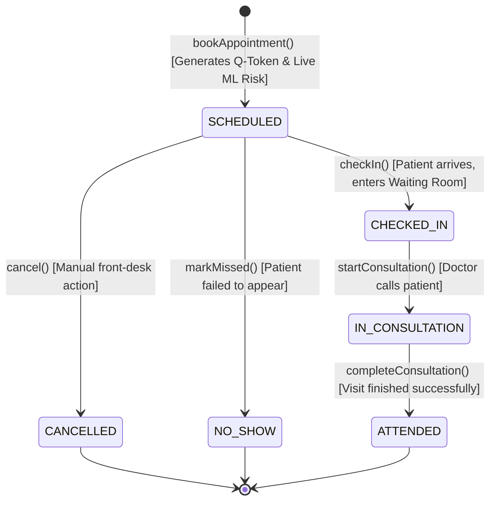

# ClinicFlow — System Architecture & Component Design

## 1. Architectural Overview

ClinicFlow follows a layered Object-Oriented architecture in Java 17, combining domain models, generic repositories, and business services with a native Weka 3.8.6 Machine Learning engine.

```mermaid
flowchart TD
    subgraph UI_Layer ["1. Presentation Layer (Java Swing Desktop UI)"]
        MainWindow["ClinicFlowApp (JFrame + Sidebar Navigation)"]
        Dashboard["DashboardPanel (KPIs & Java2D Attendance Chart)"]
        Patients["PatientManagementPanel (CRUD & Medical History)"]
        Doctors["DoctorManagementPanel (CRUD & Availability)"]
        Booking["AppointmentBookingDialog (Live ML Risk Assessment)"]
        ApptMgmt["AppointmentManagementPanel (Filtering & Lifecycle)"]
        Queue["QueueManagementPanel (FIFO Smart Waiting Room)"]
        Reminders["ReminderManagementPanel (Simulated Dispatch & Logs)"]
        MLInsights["ModelInsightsPanel (Metadata & Comparative Evaluation)"]
        About["AboutPanel (Architecture & Compliance)"]
        CLI["Main CLI Application (--cli headless verification)"]
    end

    subgraph Service_Layer ["2. Service Layer"]
        ApptService["AppointmentService\n(Booking, Queue Transitions, Token Issuance)"]
        PatientService["PatientService\n(Patient Master & Medical History)"]
        DoctorService["DoctorService\n(Doctor Master & Active Availability)"]
        ReminderService["ReminderService\n(Academic Simulation & Delivery Logging)"]
        InsightsService["ModelInsightsService\n(Weka Performance Metrics & Metadata)"]
        PredService["NoShowPredictionService (Interface)\n+ WekaNoShowPredictionService (Impl)"]
    end

    subgraph Domain_Layer ["3. Domain Model Layer"]
        Person["abstract Person"]
        Patient["Patient (extends Person)"]
        Doctor["Doctor (extends Person)"]
        Appointment["Appointment"]
        ReminderRecord["ReminderRecord"]
        PredictionResult["PredictionResult (Value Object)"]
        Enums["Enums: AttendanceStatus, RiskCategory, ReminderAction, Gender"]
    end

    subgraph Repository_Layer ["4. Repository & Storage Layer"]
        RepoInterface["Generic Repository<T, ID>"]
        PatientRepo["PatientRepository\n(CsvPatientRepository / InMemory)"]
        DoctorRepo["DoctorRepository\n(CsvDoctorRepository / InMemory)"]
        ApptRepo["AppointmentRepository\n(CsvAppointmentRepository / InMemory)"]
        ReminderRepo["ReminderRepository\n(CsvReminderRepository / InMemory)"]
        ModelRepo["ModelRepository\n(Weka Serialization Helper)"]
        AppData[("data/app/*.csv (Atomic File Swapping)")]
    end

    subgraph ML_Engine ["5. Machine Learning Engine (Weka 3.8.6)"]
        Preprocessor["DataPreprocessor\n(Cleaning & 80:20 Chronological Split)"]
        Extractor["FeatureExtractor\n(Schema & Vector Extraction)"]
        Trainer["NoShowModelTrainer\n(Random Forest 100 Trees)"]
        Evaluator["ModelEvaluator\n(Metrics & Reports Generator)"]
        Predictor["NoShowPredictor\n(Runtime Inference Distribution)"]
        ModelFile[("models/no-show-random-forest.model (233.9 MB)")]
    end

    MainWindow --> Dashboard
    MainWindow --> Patients
    MainWindow --> Doctors
    MainWindow --> ApptMgmt
    MainWindow --> Queue
    MainWindow --> Reminders
    MainWindow --> MLInsights
    MainWindow --> About
    ApptMgmt --> Booking
    CLI --> ApptService

    Dashboard --> ApptService
    Patients --> PatientService
    Doctors --> DoctorService
    Booking --> ApptService
    ApptMgmt --> ApptService
    Queue --> ApptService
    Reminders --> ReminderService
    MLInsights --> InsightsService

    ApptService --> PatientRepo
    ApptService --> DoctorRepo
    ApptService --> ApptRepo
    ApptService --> PredService
    PatientService --> PatientRepo
    DoctorService --> DoctorRepo
    ReminderService --> ReminderRepo
    ReminderService --> ApptRepo

    PatientRepo --> AppData
    DoctorRepo --> AppData
    ApptRepo --> AppData
    ReminderRepo --> AppData

    PredService --> Predictor
    Predictor --> Extractor
    Predictor --> ModelFile
    Trainer --> Preprocessor
    Trainer --> Extractor
    Trainer --> Evaluator
    Trainer --> ModelRepo
    ModelRepo --> ModelFile

---

## 2. Component Collaboration & Runtime Prediction Sequence

```mermaid
sequenceDiagram
    autonumber
    actor Receptionist
    participant Service as AppointmentService
    participant Repo as AppointmentRepository
    participant PredService as WekaNoShowPredictionService
    participant Predictor as NoShowPredictor
    participant WekaModel as RandomForest (Loaded Model)

    Receptionist->>Service: bookAppointment(apptId, patientId, doctor, schedDay, apptDay, district)
    Service->>Service: validateAppointment(appointment)
    Service->>PredService: predict(appointment)
    alt Model Loaded & Ready
        PredService->>Predictor: predict(appointment)
        Predictor->>Predictor: extractInstance(appointment) [6 features]
        Predictor->>WekaModel: distributionForInstance(instance)
        WekaModel-->>Predictor: [pAttended=0.44, pNoShow=0.56]
        Predictor-->>PredService: PredictionResult[YES, 56.09%, HIGH, PHONE_CALL]
        PredService-->>Service: PredictionResult
    else Model Not Loaded
        PredService-->>Service: PredictionResult.unavailable() [ML MODEL NOT TRAINED OR AVAILABLE]
    end
    Service->>Repo: save(appointment)
    Service-->>Receptionist: Appointment (with ML Prediction & Suggested Action)
```

---

## 3. Storage Separation Policy

1. `data/raw/`: Original Kaggle dataset (`appointments.csv`, 110,527 records). Preserved strictly intact.
2. `data/processed/`: Programmatically cleaned dataset (`clean_appointments.csv`, 110,521 records).
3. `data/app/`: Operational runtime clinic bookings created through the application interface (`patients.csv`, `doctors.csv`, `appointments.csv`, `reminders.csv`). All writes use atomic temporary file replacement (`.tmp` -> replace).
4. `models/`: Serialized trained Weka model (`no-show-random-forest.model`) and metadata (`model-metadata.ser`, `model-metadata.txt`).
5. `reports/`: Audit logs, metrics, confusion matrix, and sample predictions.

---

## 4. Appointment Lifecycle & State Transitions



---

## 5. UI Concurrency & Model Loading Architecture

Loading the 233.9 MB Random Forest (100 Weka decision trees) takes approximately 4.8 seconds. If executed on the Event Dispatch Thread (EDT), the desktop window would freeze. ClinicFlow resolves this using Java Swing's asynchronous worker model:

1. **Main Thread / EDT:** Launches `ClinicFlowApp` JFrame immediately (< 400ms). All UI controls are responsive.
2. **Background Thread (`SwingWorker<Boolean, Void>`):** Deserializes `no-show-random-forest.model` from disk into memory.
3. **Status Bar Indicator:** Displays animated progress and "Loading ML Model (234 MB) in background...".
4. **Completion Callback (`done()` on EDT):** Status bar updates to "● ML Model Ready (Balanced Random Forest: 100 Trees | Acc: 77.50% | Recall: 32.93%)" and notifies panels. Booking dialog ML risk previews immediately switch from initial loading state to active Weka inference.
