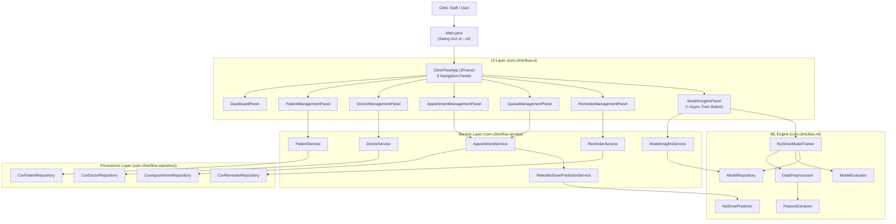
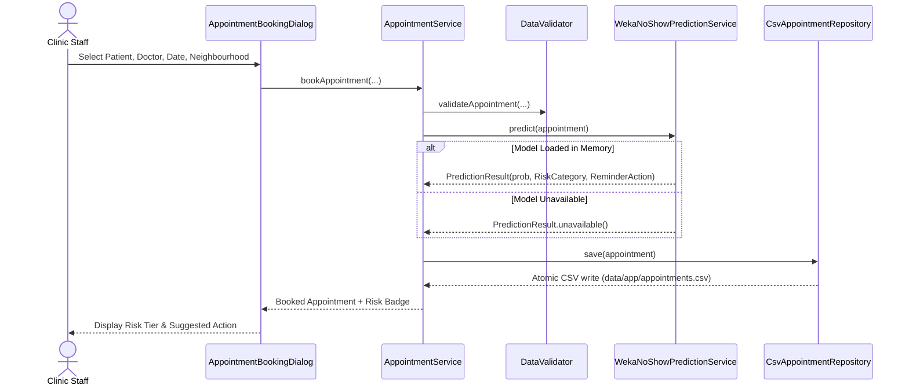
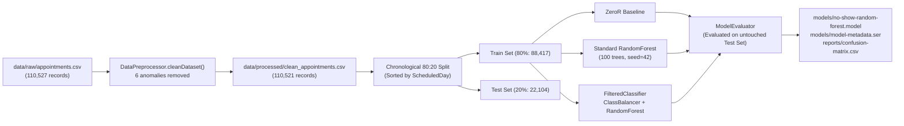
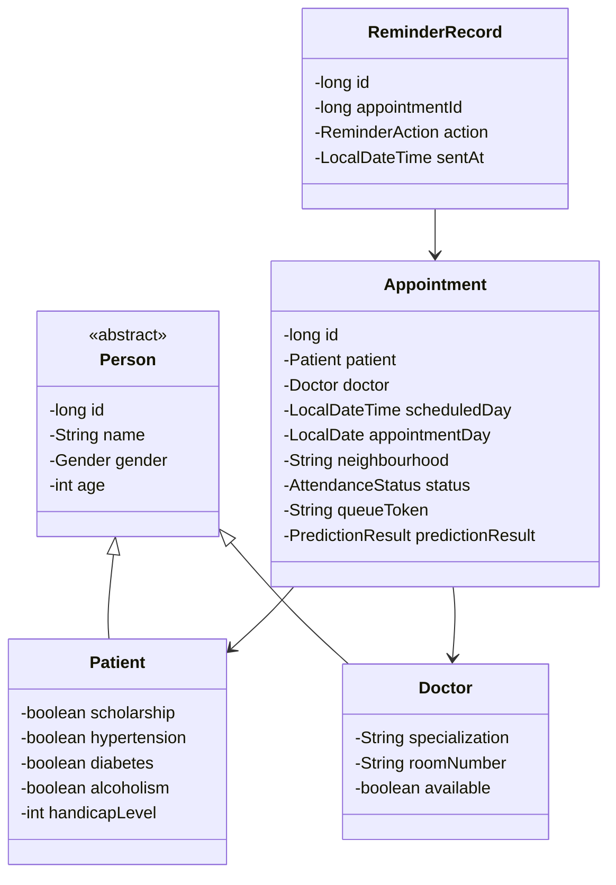

# ClinicFlow Architecture & Workflow Diagrams

All diagrams below reflect the actual implementation in `clinicflow/src/main/java/com/clinicflow/`.

## 1. System Architecture

## 2. Appointment Booking & Live ML Inference Workflow

## 3. ML Training & Evaluation Pipeline

## 4. Domain Model & Repository Design

